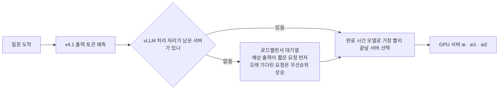

# QLess 주간 보고서 · 2026년 11월 3주차

작성일: 2026-11-17 · 대상: 출력 토큰 예측기, 로드밸런서

## 1. 이번 주 요약

- **출력 토큰 예측 오차를 64% 줄였다.** 학습에 쓰지 않은 최근 2,777건에서 자연 종료한 응답의 평균 오차는 기존 예측기 471.7토큰, 새 예측기 v4.1 171.5토큰이다. 실제 GPU에서 처음 본 요청 54건에서도 486.4 → 178.0토큰으로 63% 줄었다.
- **서버별 완료 시간 예측 오차를 15.8초에서 2.89초로 줄였다.** 실제 완료 순서를 맞히는 정도(τ)는 LinUCB 점수 0.214, 기존 계산식 0.224, 새 완료 시간 모델 0.732다.
- **실제 GPU 3대에서 사용자 대기 시간을 줄였다.** 처음 본 요청 60건을 연속으로 보냈을 때, 짧은 요청 우선 대기열은 Round Robin보다 평균 완료 시간을 36.0 → 28.4초(21%), 2초 초과율을 76.7 → 60.0%로 낮췄다.
- **서버 선택 방식만 바꾼 효과는 작았다.** 세 서버가 모두 바쁠 때 Round Robin, LinUCB, v4 완료 시간 모델의 차이는 1초 안팎이었다. 개선은 대기열에서 처리 순서를 바꾼 데서 나왔다.
- **운영 정책은 바꾸지 않았다.** 실제 사용자 요청은 기존 예측기와 운영 LinUCB를 그대로 쓰고, 새 모델은 실험 요청에만 적용했다.

## 2. 실험 환경

| 항목 | 내용 |
|---|---|
| GPU 서버 | ai, ai1, ai2 · AWS g5.xlarge(NVIDIA A10G) 3대 |
| 답변 모델 | Qwen3-8B-AWQ · vLLM · 서버당 동시 처리 4건(`max-num-seqs 4`) · 컨텍스트 16,384토큰 |
| 로드밸런서 | aic-10 · FastAPI · 서버당 최대 6건 배정 · 서버 상태 3초마다 수집 |
| 상시 실험 | 10만 건 질문 묶음 · 출력 상한 2,000토큰 · 11/17 기준 약 18,500건 완료 |
| 질문 종류 | 코드 리뷰, JSON 변환, 문서 요약, 표·목록 정리, 아이디어 제안, 한 문장 답변 등(한국어·영어) |
| 대시보드 | [qless.bluecl.cloud](https://qless.bluecl.cloud/) · 상세 분석 탭에 결과 표시 |

## 3. 이번 주 진행 순서

| 날짜 | 한 일 | 결과 |
|---|---|---|
| 11/09–11/15 | 석진 님의 출력 예측기와 LinUCB 로드밸런서를 GPU 3대에 연결하고 같은 질문 248건씩 비교 | 두 정책의 차이는 거의 없었고, 동시 요청 19건부터 대기가 생겼다 |
| ~11/15 | 운영 모니터링 추가: 요청 기록, GPU·CPU·메모리 3초 수집, 장애 기준, GPU 서버 요청 가동 시간 | 대시보드 상세 분석에서 실시간 확인 |
| 11/15 | 초기 실험은 출력 상한이 낮아 짧게 끝난 응답 위주였다(실제 평균 약 64~74토큰, 첫 100건 오차율 1,286.5%) | 상한을 2,000토큰으로 올리고 10만 건을 처음부터 다시 시작했다. 이후 자연 종료 응답의 실제 평균은 약 913토큰이다 |
| 11/15 | 출력 예측기 v3: 답변 형식·키워드 특징 추가, 주제 특징 제외 | 요소별 기여: 형식 −53.25, 키워드 −6.68, 주제 +8.45토큰 |
| 11/15 | 100건 학습 → 100건 고정 평가를 반복하는 체크포인트 실험 시작 | 세 배정 정책(Round Robin, 예상 완료 시간 최소, 실험 LinUCB)을 같은 질문으로 비교 |
| 11/16 | 평가 구간 91개 분석 | v3 오차 464.2 → 447.4토큰(3.6%↓). 정책별 첫 응답 P95는 5.84~5.93초로 차이가 없었다 |
| 11/16 | 영어 고정 질문 12개로 기존·v3 예측기 비교, 긴 작업 중 짧은 질문 테스트 | 같은 출력 길이 29쌍에서 483 → 456토큰(5.5%↓). 당시에는 대기열이 실제로 쌓이지 않았다(로드밸런서 대기 약 1ms) |
| 11/17 | 긴 요청을 6 → 12 → 18건으로 늘려 실제 대기열 재현 | 18건에서 세 서버 모두 vLLM 대기 2건. 짧은 질문 첫 응답 P95 21.9~26.6초, 세 정책 모두 2초 초과 100% |
| 11/17 | 학습에 없던 한국어 질문 30개로 유형별 비교(v3) | 한 문장 405.7 → 9.3, 코드 286.2 → 121.8토큰은 개선. 목록 101.8 → 96.5, JSON 335.7 → 336.5토큰은 거의 그대로 |
| 11/17 | **v4 개발**: 문장 학습 출력 예측기, 완료 시간 모델, 짧은 요청 우선 대기열 | 5~6장 참고 |

## 4. 기존 방식에서 성과가 나지 않은 이유

**1) 출력 예측기가 질문 내용을 충분히 읽지 못했다.** 기존 예측기는 입력 토큰 수와 질문 분류만 썼고, v3는 정해진 키워드와 형식 규칙을 추가한 수준이었다. 시험 구간 질문의 88%는 학습 구간에 없던 지시문이어서, 키워드 목록만으로는 새 질문의 답변 길이를 맞히기 어려웠다. 답변 길이 순서 일치도도 기존 0.208, v3 0.406에 그쳤다.

**2) LinUCB 점수가 실제 완료 순서를 거의 맞히지 못했다.** LinUCB 점수의 순서 일치도는 0.214였다. LinUCB는 부정확한 출력 예측값을 입력으로 받고, 답변 생성 시간까지 포함한 전체 시간을 보상으로 쓴다. 그래서 요청이 늦게 끝났을 때, 배정이 잘못된 건지 답변이 길었던 건지 구분하기 어렵다. 세 서버의 사양도 같아서 서버 간 차이로 배울 정보가 적었다.

**3) 혼잡할 때의 병목은 서버 선택보다 빈 처리 자리를 기다리는 시간이었다.** 로드밸런서는 서버마다 6건까지 보내지만, vLLM은 동시에 4건만 처리한다. 나머지 2건은 vLLM 안에서 도착 순서대로 기다린다. 세 서버가 모두 차 있으면 어느 서버를 골라도 기다리는 시간은 비슷하다.

## 5. 바꾼 방식

| 구분 | 기존 | 변경 |
|---|---|---|
| 출력 예측 입력 | 입력 토큰 수, 질문 분류. v3는 정규식 키워드·형식 | 질문 문장 전체와 길이 지시(“한 문장”, “30개 섹션”, “자세히” 등) |
| 출력 예측 모델 | 기존 회귀 모델. v3는 선형 로그 길이 모델 | TF-IDF Ridge + SVD + 그래디언트 부스팅 |
| 서버 선택 | 운영 LinUCB 점수. 예상 완료 시간은 고정 처리 속도 공식으로 계산 | 실제 배정 기록으로 학습한 서버별 완료 시간 모델 |
| 대기 처리 | 서버당 6건까지 바로 전달. vLLM 안에서 도착 순서로 대기 | 서버당 4건까지만 전달. 나머지는 로드밸런서에서 짧은 예측 우선 |
| 적용 범위 | 운영 요청 | 실험 요청 전용(`v4_eval`, `v4_sched`) |

### 5.1 출력 토큰 예측기 v4.1

- **입력:** 질문 전문, 입력 토큰 수, 기존 예측값을 쓴다. 긴 문서가 붙은 질문은 지시문이 앞뒤에 있는 경우가 많아, 앞 1,500자와 뒤 1,500자를 사용한다.
- **구조:** 단어(1~2개 묶음)와 글자(2~4자 묶음) TF-IDF로 Ridge 회귀를 학습한다. 이 예측값, 256차원 SVD 압축값, 수치 특징, 길이 지시 특징을 그래디언트 부스팅 모델에 넣는다. Ridge 예측값은 5겹 교차 검증으로 만들어 학습 정답이 섞이지 않게 했다.
- **길이 지시 특징:** 한 문장·짧게, 상세·단계별·매뉴얼, 각 섹션마다, JSON, 코드, 표, 목록, 요약, 요청한 개수, 단어·토큰 제한을 쓴다.
- **학습 데이터:** 상시 실험의 실제 응답 18,512건을 시간순 70/15/15%로 나눴다. 2,000토큰 상한에 닿은 응답도 학습에 포함했다.
- **v4.0 → v4.1:** 길이 지시 특징을 추가해 오차를 183.4 → 171.5토큰으로 줄였다.
- **실행 비용:** 예측 1회 약 33ms, 메모리 약 376MB.

**학습에 쓰지 않은 최근 2,777건(자연 종료 2,481건)**

| 모델 | 자연 종료 평균 오차 | 전체 평균 오차 | 길이 순서 일치도(τ) |
|---|---:|---:|---:|
| 기존 예측기 | 471.7토큰 | 491.4토큰 | 0.208 |
| v3 · 키워드·형식 | 399.8토큰 | 418.4토큰 | 0.406 |
| v4.0 · 문장 학습 | 183.4토큰 | 192.9토큰 | 0.721 |
| **v4.1 · 문장 학습 + 길이 지시** | **171.5토큰** | **180.6토큰** | **0.737** |

**유형별 평균 오차(토큰)**

| 유형 | 표본 | 실제 평균 | 기존 | v3 | v4.1 |
|---|---:|---:|---:|---:|---:|
| 한 문장 | 92 | 60.6 | 703.3 | 102.3 | **32.2** |
| 목록·표 | 1,565 | 939.5 | 469.5 | 421.5 | **181.2** |
| JSON | 53 | 843.3 | 359.4 | 380.4 | **169.0** |
| 코드 | 120 | 1,069.9 | 444.9 | 455.5 | **164.4** |
| 요약 | 50 | 744.4 | 418.7 | 298.3 | **147.9** |
| 기타 | 601 | 990.9 | 461.7 | 504.8 | **171.1** |

**실제 GPU에서 처음 본 요청**

| 실험 | 자연 종료 | 기존 | v3 | v4 |
|---|---:|---:|---:|---:|
| v4.0 · 말뭉치 60,000번대 | 51건 | 411.6토큰 | 371.3토큰 | **155.6토큰** |
| v4.1 · 말뭉치 61,000번대 | 54건 | 486.4토큰 | 385.2토큰 | **178.0토큰** |

### 5.2 서버별 완료 시간 모델

- **예측 대상:** 서버에 배정된 뒤 답변이 끝날 때까지 걸리는 시간이다.
- **입력:** 배정 순간에 알 수 있는 값만 쓴다. 입력 토큰, v4.1 예측 출력 토큰, 서버에 배정된 요청 수, vLLM 실행·대기 요청 수, KV 캐시 사용률이다.
- **제약:** 작업이 늘었는데 예측 시간이 줄어드는 일이 없도록 모든 입력에 단조 증가 제약을 걸었다. 이 제약을 넣자 오차가 3.25 → 3.04초로 줄었다.
- **선택:** 각 서버의 예상 완료 시간을 계산하고 가장 짧은 서버에 보낸다.

**실제 배정 기록 · 앞 2,777건으로 학습하고 다음 2,777건으로 평가**

| 방식 | 평균 오차 | 실제 완료 순서 일치도(τ) |
|---|---:|---:|
| 기존 예상 완료 시간 계산 | 15.8초 | 0.224 |
| 운영 LinUCB 점수 | — | 0.214 |
| **v4 완료 시간 모델** | **2.89초** | **0.732** |

실제 출력 길이를 미리 안다고 가정하면 오차는 약 1초까지 줄어든다. 남은 오차의 대부분은 출력 길이 예측에서 나오므로, 출력 예측기를 더 개선하면 완료 시간 예측도 함께 좋아진다.

### 5.3 짧은 요청 우선 대기열

- 서버마다 vLLM이 동시에 처리할 수 있는 4건까지만 보낸다. 나머지 요청은 순서를 바꿀 수 있는 로드밸런서 대기열에서 기다린다.
- 우선순위는 `예상 출력 토큰 ÷ 70 − 노화 가중치 × 기다린 시간(초)`으로 정한다. 70은 요청 하나의 대략적인 생성 속도(토큰/초)다. 짧은 요청이 먼저 나가고, 오래 기다린 긴 요청은 점점 앞으로 온다.
- 같은 요청 60건을 평균 1초 간격으로 보내는 조건에서 Round Robin과 비교했다. 버전마다 다른 60건을 사용했다.

| 시도 | 설정 | 첫 응답 P95 | 2초 초과율 | 완료 평균 | 긴 요청 완료 P95 | 판단 |
|---|---|---|---|---|---|---|
| 1차 · 2회 | 노화 1.0 + 짧은 요청용 자리 1개 예약 | 37.9 → 48.7초 | 74.2 → 53.3% | 29.1 → 26.4초 | 58.5 → 73.8초 | 평균은 줄었지만 꼬리 지연이 크게 늘었다 |
| 2차 · 3회 | 노화 3.0 + 예약 | 35.4 → 43.7초 | 76.7 → 78.3% | 29.1 → 30.2초 | 50.5 → 62.8초 | 모든 지표가 나빠졌다 |
| **3차 · 3회** | **노화 1.0, 예약 없음** | **44.3 → 39.8초** | **76.7 → 60.0%** | **36.0 → 28.4초** | 63.9 → 66.3초 | 채택. 긴 요청 P95만 2.4초 늘었다 |

2차가 나빠진 뒤 저장된 요청 기록으로 재생 시뮬레이션을 돌렸다. 처리 자리 예약은 시뮬레이션에서도 첫 응답 P95를 늘렸다(9.8 → 13.2초). 그래서 3차에서는 예약을 빼고 노화 가중치를 1.0으로 되돌렸다.

## 6. 실제 GPU 비교 종합

**긴 요청 18건으로 세 서버를 채운 뒤 짧은 질문 4건(정책별 2회)**

네 정책 모두 짧은 질문 첫 응답 P95가 24.1~24.8초였고, 2초 초과율은 100%였다. 처리 자리가 모두 찬 순간에는 서버 선택이나 순서 조정으로 줄일 수 있는 대기가 없다.

**처음 본 요청 60건 연속 도착 · 서버 선택만 비교(v4.1 실험, 정책별 3회)**

| 정책 | 첫 응답 P95 | 2초 초과율 | 완료 평균 | 완료 P95 |
|---|---:|---:|---:|---:|
| Round Robin | 35.4초 | 76.7% | 29.1초 | 50.5초 |
| 실험 LinUCB | 34.7초 | 76.1% | 29.2초 | 49.9초 |
| v4 완료 시간 모델 | 34.9초 | 76.1% | 29.3초 | 49.0초 |

서버 선택 방식을 바꿔도 차이는 1초 안팎이었다. 사용자 대기를 줄인 것은 5.3의 짧은 요청 우선 대기열이었다.

## 7. 한계

- 정책별 반복은 2~3회이고, 회차당 요청은 60건이다. 결론을 확정하려면 반복 횟수를 늘려야 한다.
- 학습과 검증에 쓴 질문은 실험용으로 만든 질문 묶음이다. 실제 사용자 질문은 아직 5건이라 운영 적용 전에 다시 검증해야 한다.
- 짧은 요청 우선 대기열은 긴 요청 완료 P95를 2.4초 늘렸다.
- 2초 초과율이 60%로 여전히 높다. 동시 처리량이 서버 3대 × 4건으로 제한돼 있기 때문이다.

## 8. 다음 주 계획

1. **짧은 요청 우선 대기열 반복 검증:** 노화 가중치 0.5~2.0을 정책당 5회 이상 비교하고, 긴 요청의 최대 대기 시간 상한을 정한다.
2. **vLLM 동시 처리 수 4 → 6 실측:** 단순 재생 시뮬레이션에서는 첫 응답 P95가 크게 줄었다. 다만 동시 처리 수가 늘면 요청당 생성 속도가 느려지는데, 이 효과를 반영하지 못했다. GPU 메모리와 KV 캐시 여유를 확인한 뒤 실측한다.
3. **v4.1 주기적 재학습과 운영 전환 기준:** 실제 사용자 질문으로 오차를 다시 확인한다. 실측에서 평균 완료 시간 10% 이상 단축, 긴 요청 P95 악화 5% 이내를 운영 전환 기준 초안으로 둔다.
4. **LinUCB 보상 재설계:** 보상을 대기 시간과 첫 응답 시간 중심으로 바꾸고, 생성 시간은 출력 토큰 수로 정규화한다. LinUCB가 v4 완료 시간 모델의 예측 오차만 보정하는 구조도 비교한다.
5. **대시보드:** v4 정책의 실시간 대기열과 배정 근거를 표시한다.

## 9. 발표 핵심 메시지

- 답변 길이는 질문 문장을 읽어야 맞힐 수 있다. 문장 학습으로 출력 토큰 예측 오차를 기존 471.7 → 171.5토큰, 64% 줄였다.
- 서버가 모두 바쁠 때는 서버를 잘 고르는 것보다 누구를 먼저 처리할지가 중요하다. 예측한 답변 길이로 순서를 정해 평균 완료 시간을 21% 줄였다.
- 운영은 그대로 두고 실험 요청에서만 검증했다. 다음 주에는 반복 검증과 동시 처리량 확대 실험으로 운영 적용 여부를 판단한다.

## 10. 관련 코드와 기록

| 내용 | 위치 |
|---|---|
| v4.1 출력 예측기 | [deploy/aic-10/length_v4.py](../deploy/aic-10/length_v4.py) |
| 예측기·완료 시간 모델 학습과 평가 | [deploy/aic-10/train_models_v4.py](../deploy/aic-10/train_models_v4.py) |
| 실험 전용 v4 배정 정책 | [deploy/aic-10/enable-v4-policy.py](../deploy/aic-10/enable-v4-policy.py), [install-v4-policy.sh](../deploy/aic-10/install-v4-policy.sh) |
| 실제 GPU 비교 | [compare_v4.py](../deploy/aic-10/compare_v4.py), [compare_queued.py](../deploy/aic-10/compare_queued.py), [compare_fixed.py](../deploy/aic-10/compare_fixed.py), [compare_korean.py](../deploy/aic-10/compare_korean.py) |
| 실험 전략과 상세 기록 | [전략.md](../전략.md) |
| 대시보드 결과 | [상세 분석](https://qless.bluecl.cloud/#analysis) · v4 모델 · 오프라인 검증과 실제 GPU 비교 |
